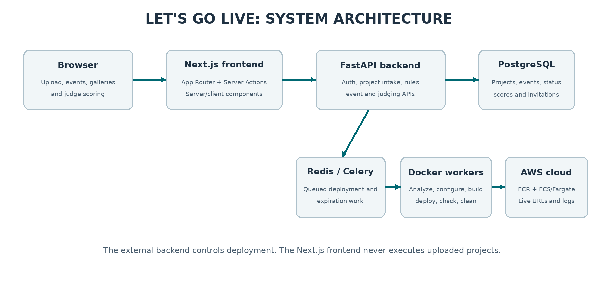
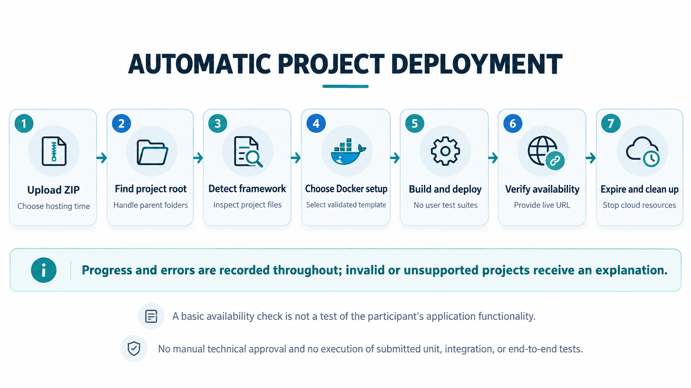
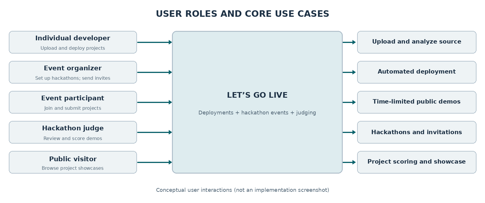

# Let's Go Live

**Upload. Deploy. Share. Organize. Judge.**

**University of Cincinnati | Senior Design Project | 2026–2027**

Let's Go Live is a web platform designed to make it easier to publish web applications and run hackathons. Students, beginner developers, workshop presenters, and people creating apps with AI-assisted tools (often called _vibe coding_) can upload a ZIP file and share a working demonstration without needing to learn complex cloud deployment steps. The same platform helps hackathon organizers manage events, participants, submissions, judges, and scores.

> **Project status:** This README describes the planned product and its design. It does not claim that every feature or cloud integration has already been implemented.

## The problem

Creating a web app is becoming more accessible, but putting it online can still require framework-specific setup, command-line tools, container configuration, and cloud knowledge. These steps can get in the way of classroom demonstrations, workshops, and short project showcases.

Hackathons have a related problem: organizers may use separate tools for invitations, submission links, project galleries, judging, and scores. When project demos are scattered across services or stop working, reviewing submissions becomes harder.

## Our solution

Let's Go Live brings **simple application deployment** and **hackathon management** together in one place.

### For developers and workshop participants

- Upload a web application as a **ZIP file**—no GitHub repository or command-line workflow is required from the user.
- Automatically locate the actual application folder, even if the ZIP contains extra enclosing folders or common unnecessary files.
- Identify supported project types using predictable rules based on project files and configuration.
- Prepare a compatible Docker build, start the application, and check whether the deployed service responds.
- Provide deployment status, understandable errors, and a shareable URL when the application becomes available.
- Allow the user to choose a temporary hosting period, stop an application early, and automatically clean up resources when hosting expires.

**Targeted project types:** Express, Flask, FastAPI, Next.js (server-rendered and static export), Vite, Create React App, and standard static HTML/CSS/JavaScript sites. Supported projects with a suitable existing Dockerfile may also use it.

### For hackathons

- **Organizers** create events, invite participants and judges, manage deadlines, and view submissions and results.
- **Participants** submit their deployed projects for an event.
- **Judges** review project information and demonstrations, then enter scores using the event's judging criteria.
- **Visitors** browse project showcases when those projects are available for public viewing.

## Project artifacts

The three diagrams below are included in the [`artifacts/`](artifacts/) folder and appear directly in this README on GitHub.

### 1. System architecture

The proposed architecture separates the user-facing website from the backend services responsible for project uploads, event management, deployment work, and data storage. Simulated deployment is the primary development path, with limited AWS deployments for real-world demonstrations.



[View the full architecture diagram](artifacts/system-architecture.png)

### 2. Automatic deployment workflow

This diagram shows the intended journey from ZIP upload to a live demo and scheduled cleanup. The platform checks that the application is available; it **does not run participants' unit, integration, or end-to-end test suites** or require manual technical approval.



[View the full deployment workflow diagram](artifacts/deployment-workflow.png)

### 3. User roles and use cases

This diagram shows how individual developers, hackathon organizers, participants, judges, and visitors use Let's Go Live.



[View the full user-role diagram](artifacts/user-roles-use-cases.png)

## Technical approach (planned)

| Component                       | Purpose                                                                                                  |
| ------------------------------- | -------------------------------------------------------------------------------------------------------- |
| **Next.js + TypeScript**        | Web interface for uploads, dashboards, events, galleries, and scoring.                                   |
| **FastAPI**                     | Backend services for project intake, authorization, deployment management, and hackathon functionality.  |
| **PostgreSQL**                  | Store project, event, invitation, deployment, and judging records.                                       |
| **Redis + Celery**              | Handle longer-running deployment and expiration jobs outside the user's browser request.                 |
| **Docker**                      | Package and run supported applications using framework-appropriate configurations.                       |
| **Simulated deployments / AWS** | Use simulation for most development and demonstrations; use AWS selectively to demonstrate real hosting. |

The deployment engine is designed to **identify frameworks and select deployment configurations without AI-based planning**. Uploaded source code is not treated as trusted: ZIP files are handled with basic extraction safeguards, and deployment jobs should run with limits and appropriate separation from the main platform.

## Intended deployment experience

1. Select a ZIP archive and a temporary hosting duration.
2. Let the platform find the application root and determine its framework.
3. Build and launch the application using the matching deployment strategy.
4. Follow status updates and read clear error messages if something fails.
5. Share the resulting URL, then let the platform remove the deployment at the end of its hosting period.

The platform's availability check only establishes that the deployment responds; it does **not** certify that the submitted application's features are correct.

## Scope and responsible use

Let's Go Live is an academic prototype, not a general-purpose production hosting guarantee. Users remain responsible for the content, functionality, and licensing of applications they upload. Event access and judging permissions should follow the roles assigned by organizers. Temporary hosting and automatic cleanup are intended to reduce unused infrastructure and unnecessary cloud costs.

## Team

- **Rahim Zowange**
- **Andrew Sellars**
- **Obadah Daraghmeh**

**Faculty advisor:** Daniel Schaupner

## Files in this package

```text
LetsGoLive_README_Package/
├── README.md
└── artifacts/
    ├── system-architecture.png
    ├── deployment-workflow.png
    └── user-roles-use-cases.png
```

To use this in a GitHub repository, copy `README.md` and the entire `artifacts/` folder into the repository's top level. Keep the same folder names so the images render correctly.
